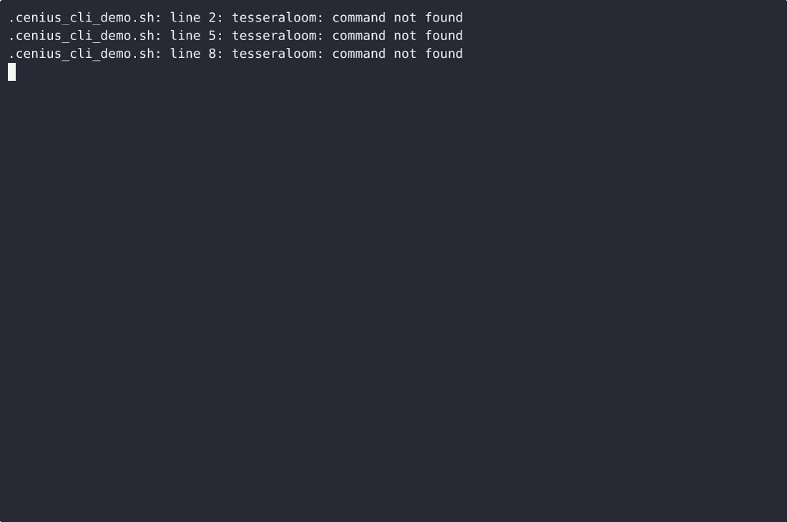
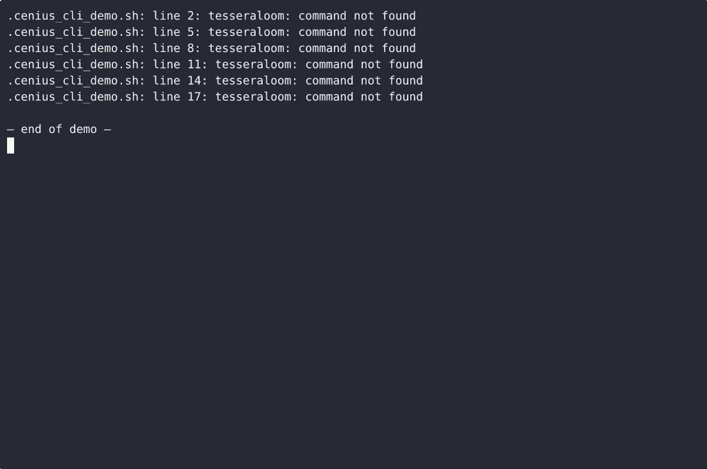

# TesseraLoom — complete Full-stack app command-line tool example app

Most open-source command-line tool projects ship a skeleton. **TesseraLoom** ships the whole thing: production-ready Full-stack app source, seeded demo data, and a TesseraLoom install script that runs in minutes. TesseraLoom is a single-file, standard-library-only Python CLI that reads a typed text grid of mosaic color codes, prints it as a numbered grid layout with a color-number legend, tallies tile counts per color code, an…. Apache-2.0-licensed — [remix TesseraLoom on cenius.ai](https://cenius.ai/marketplace/p/tesseraloom?ref=gh&utm_campaign=tesseraloom-webapp) for your own branded build.


[](LICENSE)  [](https://cenius.ai)

[](https://cenius.ai/marketplace/p/tesseraloom?ref=gh&utm_campaign=tesseraloom-webapp)

> **▶ [Open & edit in cenius.ai](https://cenius.ai/marketplace/p/tesseraloom?ref=gh&utm_campaign=tesseraloom-webapp)** — one click to an editable workspace: describe changes in plain English, get an instant preview, one-click deploy and host. Modifications made on the platform come with full rebrand & relicense rights.

_Local clone? See [Quick start](#quick-start) below. cenius.ai is the zero-setup path._

## Demo


▶ **[Full demo walkthrough](https://cenius.ai/marketplace/p/tesseraloom?ref=gh&utm_campaign=tesseraloom-webapp)** — watch it on the project page · [download MP4](.github/media/demo.mp4)

## Screenshots

 

## Features

- Numbered grid layout
- Tile counts per color
- Cut list export by color code

## Quick start

```bash
./install.sh   # installs dependencies + seeds demo data
```

See [`INSTALL.md`](INSTALL.md) for full setup and usage instructions.

## Usage guide

Three commands, one shared grid loader, one shared color numbering.

```bash
python3 tesseraloom.py --help          # commands, input forms, flags, exit codes
python3 tesseraloom.py <cmd> --help    # per-command help
```

The grid source is always the optional first positional argument:

| Form | Meaning |
| --- | --- |
| `grid.txt` | read the design from that file |
| `-` | read the design from stdin |
| omitted | read the design from stdin (same as `-`) |

If stdin is a terminal and no path was given, the tool refuses with one line
instead of hanging: `no grid on stdin; pass a grid PATH, use '-' for stdin, or
pipe a grid in`.

### layout — the numbered map

```bash
python3 tesseraloom.py layout sample_grid.txt --legend legend.txt
```

- the map keeps the grid's rows and columns; each code becomes its color number,
  right-aligned to the width of the largest number so multi-digit numbers do not
  break the shape;
- a single blank line separates the map from the legend;
- the legend lists number, code, and — when `--legend` is supplied — the name;
- numbers are assigned by first appearance (row by row, left to right), so
  `K B A / B A Z` numbers `K=1 B=2 A=3 Z=4` — not alphabetical.

#### Undefined codes

`--legend PATH` is an independent known-code list (`CODE [name]` per line).
Any grid code missing from it produces exactly one warning on stderr, naming the
code and its first row and column, and the map still prints:

_Full guide: [`USAGE.md`](USAGE.md)_

## Architecture

A self-contained Full-stack app project (18 files): top-level directories include `examples/`, `tests/`. Starting up is just `./install.sh`: it installs what is needed and pre-fills the database so you have data to work with straight away. For environment-specific setup, see [`INSTALL.md`](INSTALL.md).

## FAQ

### What does it take to self-host TesseraLoom?

`git clone` + `./install.sh` gets you a running instance — the install script provisions dependencies and demo data. Full steps live in [`INSTALL.md`](INSTALL.md); nothing external is needed to try it.

### How is TesseraLoom built technically?

Full-stack app end-to-end. Every file you need to run the app is here in this repository — code, configuration, seed data. Highlights include numbered grid layout.

### Does the TesseraLoom license allow commercial use?

Yes — it ships under the Apache-2.0 license, which permits commercial use, modification and redistribution. The full text is in [LICENSE](LICENSE).

### Can I remove the TesseraLoom name and use my own?

White-labeling is supported: fork the MIT-licensed source and rebrand it yourself, or use [cenius.ai](https://cenius.ai/marketplace/p/tesseraloom?ref=gh&utm_campaign=tesseraloom-webapp) to make changes in a guided workspace — platform modifications come with full rebrand rights.

### Can I change TesseraLoom without writing code?

[cenius.ai](https://cenius.ai/marketplace/p/tesseraloom?ref=gh&utm_campaign=tesseraloom-webapp) handles the implementation. Tell it what you want in everyday words, pick up the updated build. No coding needed.

## License & rebranding

Released under the [Apache License 2.0](LICENSE) (© 2026 Cenius AI) — free for personal and commercial use. The Cenius name/logo are trademarks (see NOTICE).

**Need a customized version?** [Remix this app on cenius.ai](https://cenius.ai/marketplace/p/tesseraloom?ref=gh&utm_campaign=tesseraloom-webapp) — modifications made on the platform come with **full rebrand & relicense rights** over your derivative.

## Built with cenius.ai

This entire application — code, design, seeded demo data — was generated on **[cenius.ai](https://cenius.ai)** from a plain-English description.

- 🚀 [Build your own app on cenius.ai](https://cenius.ai)
- 🎛️ [Remix TesseraLoom on the marketplace](https://cenius.ai/marketplace/p/tesseraloom?ref=gh&utm_campaign=tesseraloom-webapp) — open it in a workspace, prompt for changes, and ship your own version.

More open-source apps: [the Cenius-ai catalog](https://github.com/Cenius-ai) · [showcase index](https://github.com/Cenius-ai/showcase)
